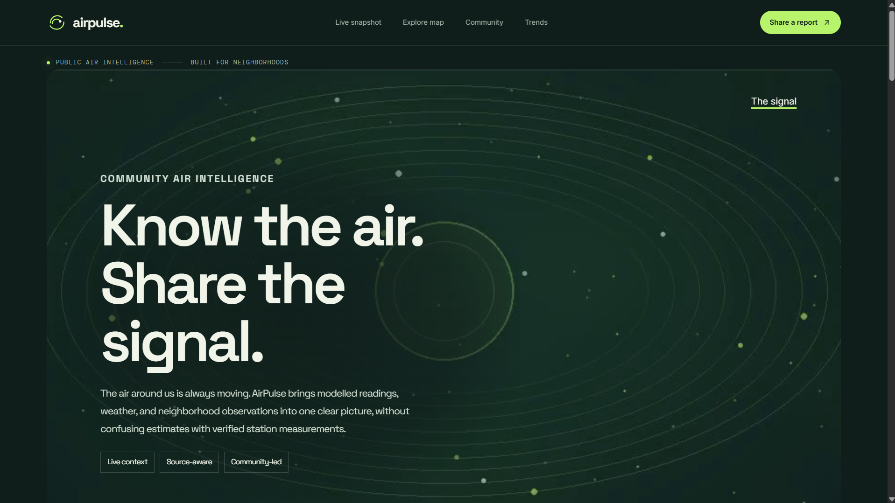
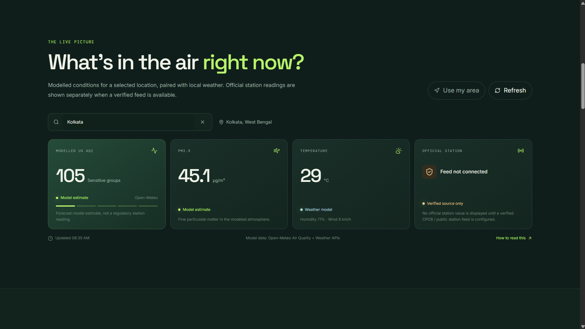
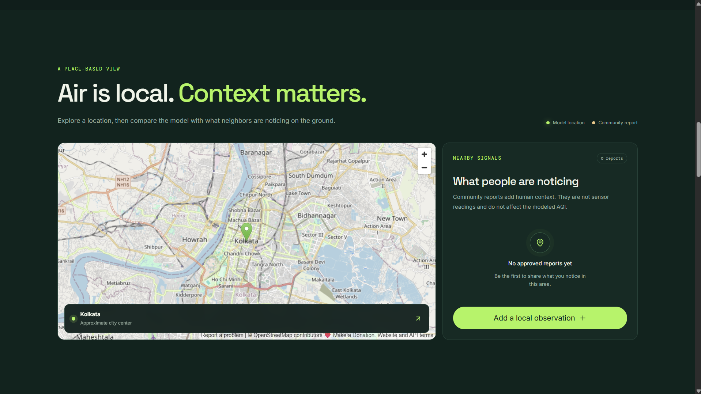
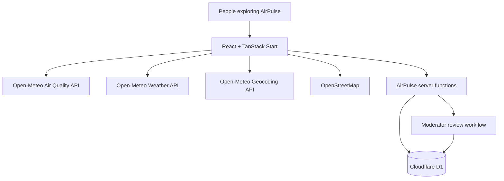

# 🌍 AirPulse — See the Air. Understand Your Neighborhood.

<p align="center">
  
  
  
  
</p>

<p align="center">
  <strong>Environmental intelligence, grounded in local context.</strong>
  <br />
  Live air-quality estimates. Weather context. Interactive maps. Community observations.
</p>

<p align="center">
  <a href="https://airpulse.moinacksaha66.workers.dev"><strong>🚀 Explore the Live Website</strong></a>
  &nbsp; · &nbsp;
  <a href="https://github.com/Moinack66/AirPulse"><strong>⭐ Explore the Source Code</strong></a>
</p>

---

## The Idea

Air pollution isn't just a number on a screen. It's the haze above a street, the dust around a construction site, and the air people experience in their own neighborhoods.

**AirPulse** is an independent environmental-tech project designed to make air-quality information more accessible and locally meaningful.

It brings together modeled air-quality estimates, current weather context, an interactive map, and community observations in one experience — while clearly distinguishing modeled data from verified monitoring-station measurements.

> **One location. Multiple signals. Clearer context.**

## 📸 Screenshots

### AirPulse Dashboard


### Air Quality Forecast & Trends


### Community Reports


[**🌐 Try AirPulse Live →**](https://airpulse.moinacksaha66.workers.dev)


## ✨ What makes AirPulse different?

| Feature | What it does |
|---|---|
| 🌫️ **Live air-quality estimates** | Displays modeled US AQI, PM2.5 and PM10 data. |
| 🌦️ **Weather context** | Shows current temperature, humidity and wind conditions. |
| 🗺️ **Interactive location explorer** | Search for places and explore them on a map. |
| 📈 **Hourly trends** | Visualizes modeled air-quality changes over the forecast window. |
| 🏘️ **Community observations** | Lets people submit neighborhood reports about dust, smoke, haze, odors and other conditions. |
| 🛡️ **Moderation workflow** | Provides a review queue for approving or rejecting submitted reports and comments. |
| 🔎 **Source transparency** | Separates model estimates, community reports and official station readings. |
| 📱 **Responsive experience** | Designed to make environmental information approachable across screen sizes. |

### 🌱 Built around a simple principle

**A model estimate is not a station measurement. A community observation is not a sensor reading.**

AirPulse keeps these distinctions visible rather than presenting different kinds of evidence as interchangeable.

---

## 🖥️ Explore the project

<p align="center">
  <a href="https://airpulse.moinacksaha66.workers.dev">
    
  </a>
</p>

Visit the live application to explore the dashboard, search for a location, inspect modeled trends, browse community observations and test the report-submission experience.

**Live application:** https://airpulse.moinacksaha66.workers.dev

**Source repository:** https://github.com/Moinack66/AirPulse

---

## ⚙️ How it works

AirPulse combines external environmental APIs with an application backend and a persistent database for community submissions.



### Technology stack

| Layer | Technology | Purpose |
|---|---|---|
| Frontend | React 19 | Interactive user interface |
| Application framework | TanStack Start | Application routing and server functionality |
| Language | TypeScript | Typed application code |
| Styling | CSS | Responsive layouts and visual presentation |
| Icons | Lucide React | Interface iconography |
| Runtime and deployment | Cloudflare Workers | Hosting and server-side execution |
| Database | Cloudflare D1 | Persistent community reports and comments |
| Air-quality data | Open-Meteo Air Quality API | Modeled air-quality estimates |
| Weather data | Open-Meteo Weather API | Current weather context |
| Geocoding | Open-Meteo Geocoding API | Location search |
| Maps | OpenStreetMap | Map visualization |

---

## 🌍 Data sources & scientific transparency

AirPulse is built to help people interpret environmental information, not to replace official monitoring systems.

### 1. Modeled air-quality data

Air-quality estimates are retrieved from Open-Meteo and include:

- US Air Quality Index (US AQI)
- PM2.5 concentration
- PM10 concentration
- Hourly forecast trends

These values are model estimates. They may differ from measurements at a particular street or monitoring station.

Source: [Open-Meteo Air Quality API](https://open-meteo.com/en/docs/air-quality-api)

### 2. Weather data

The application retrieves weather context including temperature, relative humidity, wind speed and precipitation.

Source: [Open-Meteo Weather API](https://open-meteo.com/en/docs)

### 3. Location and maps

Location search uses the Open-Meteo Geocoding API, while the map interface uses OpenStreetMap.

- [Open-Meteo Geocoding API](https://open-meteo.com/en/docs/geocoding-api)
- [OpenStreetMap](https://www.openstreetmap.org/)

### 4. Official monitoring stations

**Verified official station data is not connected yet.** AirPulse therefore does not invent or label modeled values as official station measurements.

Connecting a verified public monitoring feed is a future development goal.

---

## 🏘️ Community-powered observations

Environmental data can benefit from local context. AirPulse lets people submit observations about what they notice in their surroundings.

Reports can include:

- An approximate neighborhood area
- An observation category
- A description of the conditions
- A timestamp

Comments provide additional context, while the moderation workflow is designed to review submissions before they become public.

### Privacy by design

AirPulse is designed to avoid requiring public identities or exact home addresses for neighborhood observations. Location information is intended to remain approximate.

Community observations should be treated as personal reports, not independently verified environmental measurements.

---

## 🔐 Moderation and backend

AirPulse uses Cloudflare D1 for persistent community data and includes server-side functionality for report submission, comments and moderation.

The review workflow supports:

- Retrieving pending reports and comments
- Approving submissions
- Rejecting submissions
- Protecting moderator actions with a server-configured secret

### Moderator configuration

The `AIRPULSE_MODERATOR_KEY` must be configured as a **Cloudflare Worker secret**, not committed to the repository or exposed in client-side code.

Never publish the moderator key in a README, source file, screenshot or public issue.

---

## 🚀 Run locally

### Prerequisites

- [Git](https://git-scm.com/)
- [Node.js](https://nodejs.org/)
- [Bun](https://bun.sh/)
- A Cloudflare account for testing the deployed backend and database

### 1. Clone the repository

```bash
git clone https://github.com/Moinack66/AirPulse.git
cd AirPulse/app
```

### 2. Install dependencies

```bash
bun install
```

### 3. Start the development server

```bash
bun run dev
```

Open the local URL printed by the development server.

### 4. Configure Cloudflare services

For backend and database development, review the Wrangler configuration and migration files before running commands against a database.

The project uses Cloudflare D1. Use a local development database for local experiments whenever possible, and confirm the target environment before applying remote migrations.

**Important:** Local frontend development and a fully configured production backend are not necessarily the same environment. Cloudflare bindings, secrets and database access must be configured appropriately for the environment being tested.

---

## 🗂️ Project structure

```text
AirPulse/
└── app/
    ├── src/
    │   ├── routes/
    │   │   ├── index.tsx
    │   │   └── __root.tsx
    │   ├── components/
    │   └── lib/
    │       ├── api/
    │       └── bindings.server.ts
    ├── migrations/
    │   └── 0001_init.sql
    ├── public/
    │   └── assets/
    ├── package.json
    ├── bun.lock
    └── wrangler.jsonc
```

*The structure above highlights the main application areas; additional files and generated framework files may be present.*

---

## 🧭 Roadmap

AirPulse is an evolving independent project. Planned improvements include:

- [ ] Connect a verified official monitoring-station data source.
- [ ] Improve station-versus-model comparisons.
- [ ] Expand historical data analysis beyond the current forecast view.
- [ ] Improve map-based exploration of nearby observations.
- [ ] Strengthen moderation, abuse prevention and backend validation.
- [ ] Add automated tests for API functions and moderation workflows.
- [ ] Improve accessibility, loading states and error handling.
- [ ] Document deployment, data provenance and operational limitations in greater detail.

Roadmap items represent future goals, not features that are already complete.

---

## 🎯 Why this project exists

AirPulse explores a practical question:

**How can environmental information become more useful at the neighborhood level without sacrificing scientific clarity or user privacy?**

Building the project involves frontend engineering, API integration, database design, server-side logic, deployment and responsible presentation of environmental data.

The goal is not simply to display an AQI number. It is to build a more understandable interface for exploring the different signals that shape how people experience the air around them.

---

## 👨‍💻 Built by Max

AirPulse is an independent project created by **Max**, exploring the intersection of environmental awareness, software engineering and human-centered technology.

Designed with a focus on transparency, useful data and thoughtful product development.

<p align="center">
  <strong>AirPulse</strong>
  <br />
  <em>See the air. Understand your neighborhood.</em>
  <br /><br />
  © 2026 AirPulse by Max
</p>

---

## 📄 License

No open-source license has been specified yet. Unless a license is added to this repository, permission to reuse, distribute or modify the code should not be assumed.

---

<p align="center">
  <sub>Environmental context for a clearer picture of the air we share.</sub>
</p>
